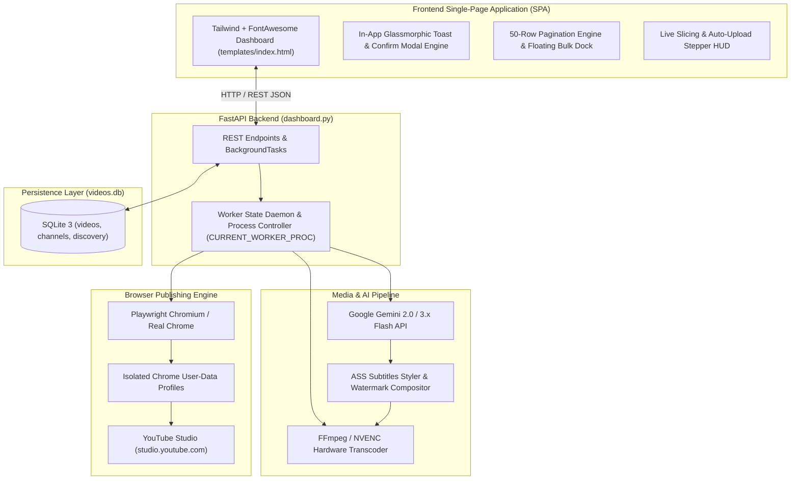

# System Architecture & Technical Specifications

**Platform:** YoutubeCeo Autonomous Studio (Multi-Tenant)  
**Repository:** `https://github.com/pardeepsinghverma/YoutubeCeo`  
**Target Environment:** Windows 10/11 x64, Python 3.10+, Google Chrome / Playwright, NVIDIA NVENC GPU Acceleration, Gemini 2.0 / 3.x Flash API.

---

## 1. High-Level Architecture Overview

YoutubeCeo is an autonomous YouTube Studio production & publishing platform. It transforms raw long-form videos into high-engagement 9:16 vertical YouTube Shorts, generates synchronized Hinglish subtitles and viral hooks with Gemini AI, schedules publication times across a calendar timeline, and uploads directly to YouTube Studio via Playwright browser automation without third-party API quotas.



---

## 2. Core Modules & Responsibilities

### 2.1 Backend Server (`dashboard.py`)
- **FastAPI Application**: Hosts the web dashboard (`/`), static assets, and REST API.
- **Process Supervisor**: Manages `WORKER_STATE` (busy status, active task, progress percentage, clean status messages) and `CURRENT_WORKER_PROC` for immediate process termination on user stop requests (`POST /api/worker/stop`).
- **Autonomous Pipelines**:
  - `bg_auto_upload`: Sequentially schedules & uploads pending videos (`METADATA_READY`) with safe cooldown buffers (4-5s) between YouTube Studio sessions.
  - `bg_create_shorts`: Slices videos, calls Gemini for subtitles, renders vertical MP4s, updates SQLite.
  - `bg_upload_single`: Isolated subprocess upload wrapper.

### 2.2 Database Layer (`db.py`)
- **Single Source of Truth**: SQLite database stored at `videos.db`.
- **Key Tables**:
  - `channels`: `id`, `channel_key`, `channel_name`, `profile_dir`, `is_authenticated`, `is_active`, `source_folder`, branding options.
  - `videos`: `id`, `channel_id`, `file_path`, `file_name`, `duration_seconds`, `width`, `height`, `is_short`, `parent_video_id`, `part_number`, `status`, `title`, `description`, `tags`, `hashtags`, `scheduled_datetime`, `youtube_url`, `last_error`.
  - `discovery_channels` & `discovery_videos`: Competitor radar monitoring (`add_discovery_channel`, `save_discovery_videos`, `get_discovery_channels`, `get_top_discovery_videos`, `delete_discovery_channel`, `delete_discovery_video`).
  - `telegram_config`: Telegram Bot credentials and review settings.
- **Multi-Tenant Logic**:
  - `get_active_channel()` dynamically retrieves active channel (falls back to lowest ID).
  - `delete_channel(channel_id, delete_videos=True)`: Enforces that the last remaining channel cannot be deleted (`COUNT(*) > 1`), cleans up associated videos/discovery data, and reassigns active status to a fallback channel.
  - `reset_channel(channel_id)`: Resets videos, queue, radar, and logs back to zero state while strictly preserving YouTube Studio authentication cookies and branding.
- **Competitor Discovery Pipeline (`discovery_engine.py`)**:
  - Scrapes channel video telemetry with flat playlist extraction (`extract_flat`) without downloading streams.
  - Computes view velocity: `view_count / days_elapsed` to spotlight viral breakouts over slowly accumulated views.
  - Persists tracked channels and video telemetry scoped by channel ID.

### 2.3 Slicing & Subtitle Engine (`shorts_generator.py`)
- **Temporal Slicing**: Converts long videos into 35-second vertical Shorts with a 5-second overlap (Part 1: 0–35s, Part 2: 30–65s, Part 3: 60–95s).
- **GPU Acceleration (`media_evasion.py`)**: Automatically detects NVIDIA NVENC (`h264_nvenc`) for high-speed hardware rendering (falls back to `libx264`).
- **Gemini Audio Transcription**: Extracts 64k mono MP3, uploads to Gemini API, prompts for conversational Hinglish subtitles and viral top hooks in JSON format.
- **ASS Subtitle Styling**: Converts SRT to styled Advanced SubStation Alpha (`.ass`) with Neon Glow effects, dual-tone word wrapping, and dynamic outro calls to action.
- **Branding Overlay**: Composites channel logo watermark and optional red `PART: X` header banner.

### 2.4 Browser Automation & Uploader (`yt_uploader.py`)
- **Playwright Persistent Context**: Launches real Google Chrome using channel-isolated profiles (`chrome_profiles/<channel_key>`).
- **Session Protection**: Cleans up stale Chromium lockfiles (`lockfile`, `SingletonLock`, `SingletonSocket`) before launch to prevent session collisions.
- **Form Automation**: Fills title, description, tags, category, age restriction (Made for Kids: No), sets publishing schedule (`scheduled_datetime`), and verifies the final uploaded URL.

### 2.5 Frontend SPA Architecture (`templates/index.html`)
- **Single-Page Application**: Built with modern Tailwind CSS, FontAwesome 6 icons, and reactive JavaScript without external framework overhead.
- **In-App Toast Engine**: Glassmorphic, non-blocking toast notifications (`Success`, `Error`, `Warning`, `Info`) with auto-dismiss timers.
- **Zero-Alert Policy & Custom Async Confirm Modal**: 100% of native browser `alert()` and `confirm()` calls are replaced with `showToast(msg, type)` and `await showConfirm(title, message, confirmText, isDanger)`.
- **Interactive 7-Day Publishing Calendar**: Visual 7-day calendar board displaying scheduled video drops with day cards, Today indicators, week navigation (`< Oct 25 - Oct 31 >`), and 1-click reschedule / upload controls, alongside a togglable Timeline List view.
- **Standardized Status Taxonomy**: Consistent terminology across badges and interactive dropdowns: `Draft / Scanned`, `Ready to Upload`, `Scheduled on YT`, `Published / Live`, `Upload Failed`.
- **Video Queue Pagination**: Client-side 50-row pagination (`25 | 50 | 100 | All`) with page controls and inventory summary.
- **Floating Bulk Actions Dock**: Slides up when 1+ videos are selected to perform AI SEO, bulk scheduling, bulk status changes, and bulk deletion.
- **Live Stepper HUD**: Displays real-time 4-stage pipeline progress (Audio ➔ Gemini AI ➔ 9:16 Render ➔ Studio Upload) with instant worker cancellation.

---

## 3. Database Schema

```
┌─────────────────────────────────┐       ┌──────────────────────────────────────┐
│            channels             │       │                videos                │
├─────────────────────────────────┤       ├──────────────────────────────────────┤
│ id (PK, INTEGER)                │◄──┐   │ id (PK, INTEGER)                     │
│ channel_key (TEXT, UNIQUE)      │   └───┤ channel_id (INTEGER, FK)             │
│ channel_name (TEXT)             │       │ file_path (TEXT)                     │
│ profile_dir (TEXT)              │       │ file_name (TEXT)                     │
│ is_authenticated (INTEGER 0/1)  │       │ duration_seconds (REAL)              │
│ is_active (INTEGER 0/1)         │       │ is_short (INTEGER 0/1)               │
│ source_folder (TEXT)            │       │ parent_video_id (INTEGER, Nullable)  │
│ show_logo (INTEGER 0/1)         │       │ part_number (INTEGER, Nullable)      │
│ logo_path (TEXT)                │       │ status (TEXT)                        │
│ thumbnail_style (TEXT)          │       │ title (TEXT)                         │
└─────────────────────────────────┘       │ scheduled_datetime (TEXT)            │
                                          │ youtube_url (TEXT)                   │
                                          │ last_error (TEXT)                    │
                                          └──────────────────────────────────────┘
```

### Video Status Taxonomy
- `SCANNED`: Raw video detected in source folder; no AI metadata generated yet.
- `METADATA_READY`: AI SEO, title, tags, description, and subtitles generated. Ready to upload.
- `SCHEDULED`: Uploaded to YouTube Studio with a future publish schedule assigned.
- `PUBLISHED`: Live on YouTube (or scheduled publish date reached).
- `FAILED`: Encountered an error during processing or upload (displays 1-click `[🔄 Retry]` button).

---

## 4. Critical Engineering Invariants

### 1. Windows UTF-8 Subprocess Invariant
> [!IMPORTANT]
> On Windows, Python's default encoding for `subprocess.run(..., text=True)` is `cp1252` (charmap). Any external tool (FFmpeg, ffprobe) outputting Unicode or Hindi characters (e.g. byte `0x81`) will crash Python with:
> `'charmap' codec can't decode byte 0x81: character maps to <undefined>`.
> **Rule**: ALWAYS specify `encoding="utf-8", errors="replace"` on all `subprocess.run` and `subprocess.Popen` calls.

### 2. Multi-Tenant Scoping Invariant
> [!IMPORTANT]
> Never assume Channel `#1` exists. Channel `#1` may be deleted if another channel is present.
> **Rule**: Always resolve the target channel via `get_channel_by_id(channel_id)` or `get_active_channel()`. In SQLite queries, always filter by `channel_id = ?`.

### 3. Chrome Singleton Concurrency Invariant
> [!IMPORTANT]
> Playwright cannot open a Chrome `user-data-dir` if another Chrome process is currently running on the same profile directory.
> **Rule**: Clean up `lockfile`, `SingletonLock`, and terminate orphaned background Chrome instances before launching `launch_persistent_context`.

### 4. No Blocking UI Alerts Invariant
> [!IMPORTANT]
> Never use `window.alert(...)` or `window.confirm(...)` in frontend code.
> **Rule**: Always use `showToast(msg, type)` and `await showConfirm(title, message, confirmText, isDanger)`.
