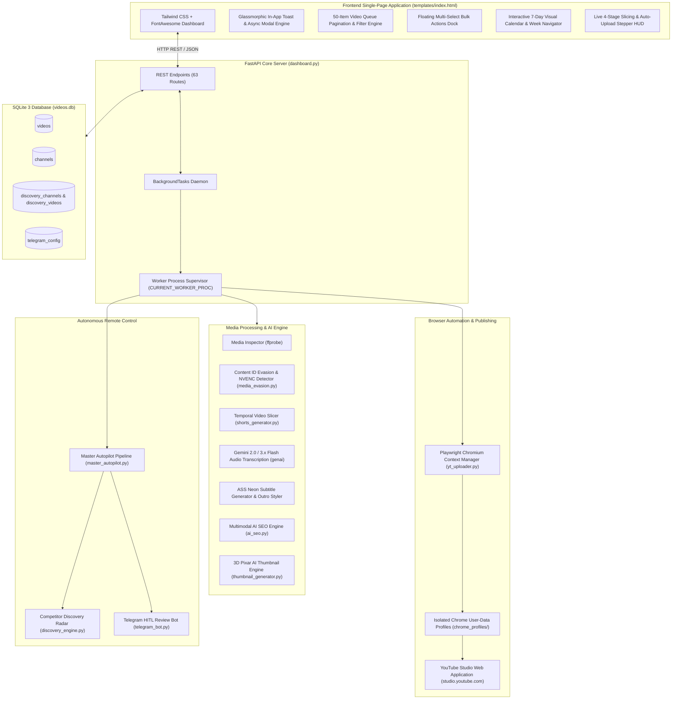

# System Architecture & Technical Specifications — YoutubeCeo

**Platform:** YoutubeCeo Autonomous Studio (Multi-Tenant)  
**Repository:** `https://github.com/pardeepsinghverma/YoutubeCeo`  
**Target Environment:** Windows 10/11 x64, Python 3.10+, Google Chrome / Playwright, NVIDIA NVENC GPU Acceleration, Gemini 2.0 / 3.x Flash API.

---

## 1. High-Level Architecture Overview

**YoutubeCeo** is an enterprise-grade, autonomous YouTube Studio production and publishing platform. It transforms raw long-form videos into high-engagement 9:16 vertical YouTube Shorts, generates synchronized Hinglish subtitles and viral hooks with Google Gemini AI, applies Content ID evasion tactics, synthesizes 3D Pixar AI thumbnails, schedules publication slots across an interactive 7-day calendar timeline, and publishes directly to YouTube Studio via Playwright browser automation without third-party API quotas.



---

## 2. Core Modules & Component Architecture

### 2.1 Backend Server (`dashboard.py`)
- **FastAPI Framework**: Serves the single-page application at `/`, static assets, and 63 REST API endpoints.
- **Worker Process Supervisor**:
  - Tracks live background state in `WORKER_STATE` (`is_busy`, `current_task`, `progress_pct`, `last_message`).
  - Holds active subprocess handle in `CURRENT_WORKER_PROC` for instantaneous cancellation via `POST /api/worker/stop`.
  - Enforces `AUTO_UPLOAD_STOP` boolean flag across sequential queue processing loops.
- **Background Task Daemons**:
  - `bg_create_shorts`: Slices raw video into 35-second segments, uploads 64k mono MP3 to Gemini for Hinglish transcription, renders vertical MP4 with ASS subtitle burn-in.
  - `bg_auto_upload`: Sequentially uploads pending `METADATA_READY` videos with 4-5s rate-limit cooldown buffers.
  - `bg_upload_single`: Dedicated one-shot upload worker.
  - `bg_scan_competitor`: Triggers yt-dlp flat playlist scraping in background.
  - `bg_master_autopilot`: Launches full hands-off autopilot pipeline.

### 2.2 Database Persistence Layer (`db.py`)
- **Engine**: SQLite 3 database located at `videos.db`. Row factory returns dictionary-like sqlite3 rows.
- **Key Tables**:
  - `channels`: Multi-tenant channel configurations (name, handle, chrome profile dir, active flag, branding settings, drop frequencies).
  - `videos`: Media inventory, resolution, duration, is_short flag, status lifecycle, AI SEO titles, descriptions, tags, scheduled publish datetimes, parent/part relationships, YouTube links.
  - `discovery_channels`: Competitor YouTube channels tracked on the viral trend radar.
  - `discovery_videos`: Scraped competitor video telemetry (view count, upload date, calculated view velocity).
  - `telegram_config`: Telegram Bot token, chat ID, and notification preference flags.
- **Multi-Tenant Scoping**:
  - Every query accepts an explicit `channel_id` or resolves via `get_active_channel()`.
  - `delete_channel(channel_id)`: Enforces that the last channel cannot be deleted (`COUNT(*) > 1`), deletes associated records, and transfers active status to a remaining channel.
  - `reset_channel(channel_id)`: Clears videos, shorts, schedule, and discovery radar for that channel while strictly preserving Google authentication session cookies and branding configuration.

### 2.3 Slicing & Subtitle Engine (`shorts_generator.py`)
- **Temporal Slicing**: Automatically decomposes long-form landscape videos into 35-second vertical Shorts (1080x1920) with a 5-second overlap (Part 1: 0–35s, Part 2: 30–65s, Part 3: 60–95s).
- **Gemini Audio Transcription**:
  - Extracts 64kbps mono MP3 from audio track.
  - Uploads to Gemini API via `google.genai.Client`.
  - Prompts Gemini for conversational Hinglish subtitles (Hindi in Roman script), short 3-5 word bursts, a punchy viral top hook, and hashtag clusters.
- **ASS Subtitle Styling**: Converts SRT to Advanced SubStation Alpha (`.ass`) with Neon Glow effects, dual-tone word coloring, and dynamic outro calls to action.
- **Visual Branding Overlay**: Composites channel logo watermark and optional red `PART: X` header banner into the video stream.

### 2.4 Content ID Evasion & GPU Acceleration (`media_evasion.py`)
- **Hardware Acceleration**:
  - Automatically probes NVIDIA NVENC (`h264_nvenc`) with `-preset p4 -cq 23`.
  - Falls back gracefully to CPU `libx264` (`-preset fast -crf 22`) if NVENC is unavailable.
- **Acoustic Fingerprint Evasion**:
  - Shifts tempo by ~3.5% using `asetpts=PTS-STARTPTS,atempo=1.035`.
  - Disrupts Chromaprint / AcoustID 12-semitone chroma distribution hashes while naturally preserving vocal pitch.
- **Perceptual Hash Evasion**:
  - Applies subtle micro-crop & zoom (`crop=iw/1.025:ih/1.025`) and color grade (`contrast=1.03:brightness=0.01:saturation=1.04`).
  - Alters spatial luminance vectors to bypass deep-neural frame matching.

### 2.5 Browser Automation & Publishing (`yt_uploader.py`)
- **Playwright Persistent Context**:
  - Uses isolated Chrome user-data profiles per channel (`chrome_profiles/<channel_key>`).
  - Uses standard real-world User-Agent headers to eliminate automation signatures.
- **Chromium Singleton Safeguard**:
  - Cleans up stale lockfiles (`lockfile`, `SingletonLock`, `SingletonSocket`) before launch.
- **Form Automation**:
  - Uploads video file, fills Title, Description, Tags, Category.
  - Configures "Made for Kids: No" and Age Restriction: No.
  - Sets future publishing schedule date & time slot in YouTube Studio date picker.
  - Verifies published/scheduled URL and records final YouTube video ID.

### 2.6 Multi-Tenant Fleet Manager (`channel_manager.py`)
- **Dynamic Profile Provisioning**: Generates dedicated Chrome directories under `chrome_profiles/` with isolated cookies and local storage.
- **Direct Cookie Auth Heartbeat**:
  - Reads Chrome SQLite cookie database (`LOGIN_INFO`, `APISID`, `SSID`, `SID`) to instantly verify active session without launching browser.
- **Interactive Login Launcher**:
  - Spawns real Chrome instance for creators to sign in to Google/YouTube Studio.

### 2.7 Competitor Discovery & Viral Trend Radar (`discovery_engine.py`)
- **Flat Playlist Scraping**:
  - Leverages `yt-dlp` with `--flat-playlist` to harvest channel video and shorts telemetry without downloading media streams.
- **View Velocity Metric**:
  $$\text{View Velocity} = \frac{\text{View Count}}{\max(\text{Days Elapsed}, 0.1)}$$
  - Spotlights breakout viral outliers over older videos that accumulated views slowly over years.

### 2.8 Human-in-the-Loop Telegram Bot (`telegram_bot.py`)
- **Remote Mobile Approval**:
  - Dispatches interactive review cards to Telegram with video title, description, hook, and thumbnail image.
  - Inline callback buttons: `[🚀 Approve & Upload Now]`, `[📅 Schedule]`, `[🔄 Regenerate SEO]`, `[❌ Reject]`.
- **Remote Status Queries**: Responds to `/status`, `/queue`, and `/stats` commands directly from Telegram chat.

### 2.9 Master Autopilot Orchestrator (`master_autopilot.py`)
- **End-to-End Hands-Off Pipeline**:
  1. Scans raw video directory for new content.
  2. Generates multimodal AI SEO titles, descriptions, and tags.
  3. Slices video into multi-part vertical Shorts with Hinglish subtitles and NVENC encoding.
  4. Synthesizes 3D Pixar AI thumbnails.
  5. Distributes publication slots across calendar drop times.
  6. Sequentially uploads to YouTube Studio via Playwright.
  7. Sends completion report to Telegram.

### 2.10 Frontend SPA Architecture (`templates/index.html`)
- **Modern Glassmorphic Dark UI**: Built with Tailwind CSS, FontAwesome 6, and reactive JavaScript.
- **In-App Toast Engine**: Glassmorphic, non-blocking toast notifications (`Success`, `Error`, `Warning`, `Info`) with auto-dismiss timers.
- **Zero-Alert Policy**: Complete elimination of native browser `alert()` and `confirm()` dialogs in favor of `showToast()` and `await showConfirm()`.
- **7-Day Visual Calendar Board**: Interactive calendar board with day cards, Today highlight, week-by-week navigation (`< Oct 25 - Oct 31 >`), and 1-click Reschedule & Studio Upload triggers, alongside a togglable Timeline List view.
- **50-Row Video Queue Pagination**: Smoothly handles catalogs of 500+ videos (`25 | 50 | 100 | All`) with search, filter, and page controls.
- **Floating Bulk Actions Dock**: Slides up when 1+ videos are selected to perform batch AI SEO, bulk scheduling, status updates, or deletion.
- **Live Stepper HUD**: Displays real-time 4-stage pipeline progress (Audio ➔ Gemini AI ➔ 9:16 Render ➔ Studio Upload) with instant worker cancellation.

---

## 3. Database Schema Reference

```
┌─────────────────────────────────┐       ┌──────────────────────────────────────┐
│            channels             │       │                videos                │
├─────────────────────────────────┤       ├──────────────────────────────────────┤
│ id (INTEGER, PK, AUTOINCREMENT) │◄──┐   │ id (INTEGER, PK, AUTOINCREMENT)      │
│ channel_key (TEXT, UNIQUE)      │   └───┤ channel_id (INTEGER, FK)             │
│ channel_name (TEXT)             │       │ file_path (TEXT, UNIQUE)             │
│ handle (TEXT)                   │       │ file_name (TEXT)                     │
│ profile_dir (TEXT)              │       │ file_size_mb (REAL)                  │
│ is_authenticated (BOOLEAN 0/1)  │       │ duration_seconds (REAL)              │
│ is_active (BOOLEAN 0/1)         │       │ width (INTEGER)                      │
│ source_folder (TEXT)            │       │ height (INTEGER)                     │
│ show_logo (BOOLEAN)             │       │ is_short (BOOLEAN 0/1)               │
│ logo_path (TEXT)                │       │ status (TEXT)                        │
│ watermark_text (TEXT)           │       │ parent_video_id (INTEGER, FK)        │
│ thumbnail_style (TEXT)          │       │ part_number (INTEGER)                │
│ schedule_frequency (TEXT)       │       │ title (TEXT)                         │
│ shorts_schedule_times (TEXT)    │       │ description (TEXT)                   │
│ long_schedule_times (TEXT)      │       │ tags (TEXT, JSON array)              │
└─────────────────────────────────┘       │ scheduled_datetime (TEXT)            │
                                          │ youtube_video_id (TEXT)              │
┌─────────────────────────────────┐       │ youtube_url (TEXT)                   │
│       discovery_channels        │       │ last_error (TEXT)                    │
├─────────────────────────────────┤       └──────────────────────────────────────┘
│ id (INTEGER, PK, AUTOINCREMENT) │◄──┐
│ channel_url (TEXT, UNIQUE)      │   │   ┌──────────────────────────────────────┐
│ channel_name (TEXT)             │   │   │           discovery_videos           │
│ handle (TEXT)                   │   │   ├──────────────────────────────────────┤
│ subscriber_count (INTEGER)      │   └───┤ discovery_channel_id (INTEGER, FK)   │
│ total_videos (INTEGER)          │       │ youtube_id (TEXT, UNIQUE)            │
│ channel_id (INTEGER, FK)        │       │ title (TEXT)                         │
│ last_scanned (TIMESTAMP)        │       │ duration_seconds (REAL)              │
└─────────────────────────────────┘       │ view_count (INTEGER)                 │
                                          │ upload_date (TEXT)                   │
┌─────────────────────────────────┐       │ view_velocity (REAL)                 │
│         telegram_config         │       │ is_short (BOOLEAN 0/1)               │
├─────────────────────────────────┤       │ tags_json (TEXT, JSON array)         │
│ id (INTEGER, PK, DEFAULT 1)     │       └──────────────────────────────────────┘
│ bot_token (TEXT)                │
│ chat_id (TEXT)                  │
│ is_enabled (BOOLEAN 0/1)        │
│ notify_on_ready (BOOLEAN)       │
│ notify_on_upload (BOOLEAN)      │
│ auto_approve (BOOLEAN)          │
└─────────────────────────────────┘
```

### Video Status Taxonomy
| Status Code | UI Display Label | Description |
|:---|:---|:---|
| `SCANNED` | **Draft / Scanned** | Video detected in folder; audio & SEO metadata pending. |
| `AI_PROCESSING` | **AI Processing** | Currently undergoing Gemini audio analysis or slicing. |
| `METADATA_READY` | **Ready to Upload** | Title, description, tags, and subtitles ready for YouTube Studio. |
| `SCHEDULED` | **Scheduled on YT** | Successfully uploaded and scheduled in YouTube Studio calendar. |
| `PUBLISHED` | **Published / Live** | Video is published and active on YouTube. |
| `FAILED` | **Upload Failed** | Upload or rendering error encountered; displays 1-click Retry button. |

---

## 4. Critical Engineering Invariants

### Invariant 1: Windows UTF-8 Subprocess Encoding
- **The Pitfall**: On Windows, Python default encoding for `subprocess.run(..., text=True)` is `cp1252` (`charmap`).
- **The Crash**: Any FFmpeg, ffprobe, or Python output containing Hindi or non-ASCII Unicode characters (e.g. byte `0x81`) crashes with:
  `'charmap' codec can't decode byte 0x81 in position ...: character maps to <undefined>`.
- **The Mandate**: You MUST always specify `encoding="utf-8", errors="replace"` in every `subprocess.run`, `subprocess.Popen`, and file `open()` call that reads or writes text.

### Invariant 2: Multi-Tenant Channel Isolation
- **The Pitfall**: Hardcoding `channel_id = 1` or assuming Channel 1 is always present. Channel 1 can be deleted by the user!
- **The Mandate**:
  - Always resolve target channel dynamically via `get_channel_by_id(channel_id)` or `get_active_channel()`.
  - Always filter SQLite queries by `channel_id = ?`.
  - Never permit deleting the last remaining channel (`COUNT(*) > 1`).
  - When deleting a channel, automatically reassign active status to a remaining fallback channel.

### Invariant 3: Chrome Profile Singleton & Concurrency
- **The Pitfall**: Playwright `launch_persistent_context` fails or crashes (`Target page, context or browser has been closed`) if another Chrome instance is using the same `user_data_dir`, or if stale lock files exist.
- **The Mandate**:
  - Clean up `lockfile`, `SingletonLock`, and `SingletonSocket` before calling `launch_persistent_context`.
  - Terminate orphaned Chrome processes associated with that profile directory before launching.

### Invariant 4: Zero Native Browser Dialogs
- **The Pitfall**: Native `window.alert()` and `window.confirm()` freeze the browser execution thread, look like Windows system errors, and break automated testing.
- **The Mandate**:
  - In frontend code (`templates/index.html`), NEVER call native `window.alert()` or `window.confirm()`.
  - Always use `showToast(message, type)` for notifications.
  - Always use `await showConfirm(title, message, confirmText, isDanger)` for confirmation modals.

### Invariant 5: Worker Process Supervision & Cancellation
- **The Mandate**:
  - Any long-running subprocess must assign its handle to `CURRENT_WORKER_PROC`.
  - Check `AUTO_UPLOAD_STOP` periodically in sequential loops.
  - Endpoint `POST /api/worker/stop` must terminate `CURRENT_WORKER_PROC`, terminate orphan Chrome instances, and set `WORKER_STATE["is_busy"] = False`.
