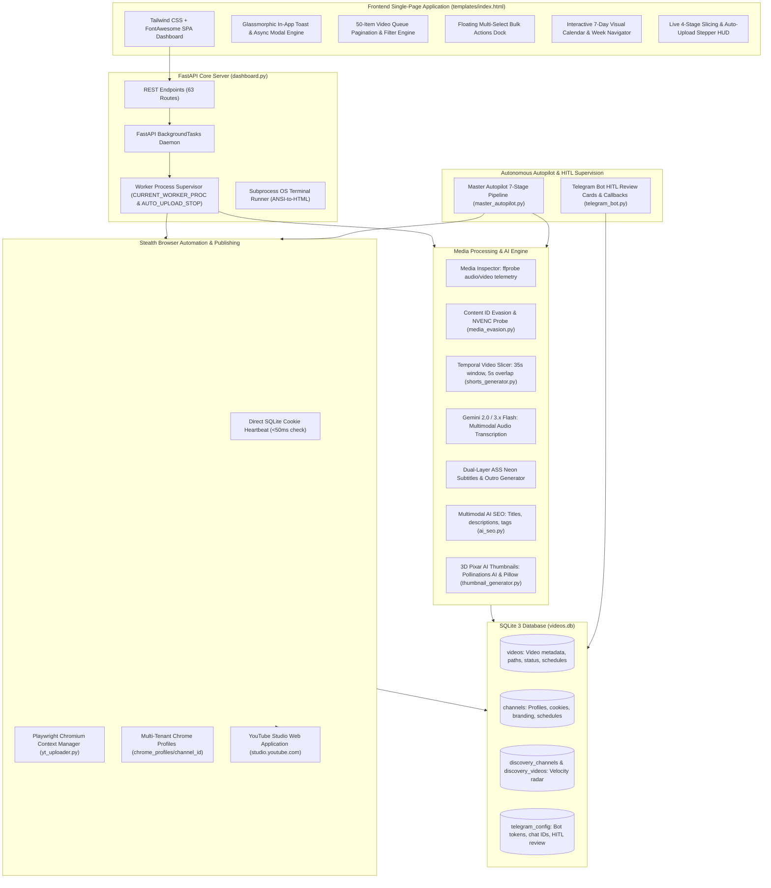
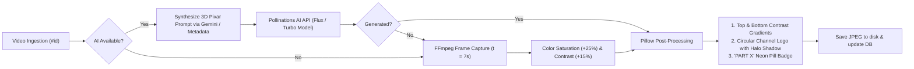
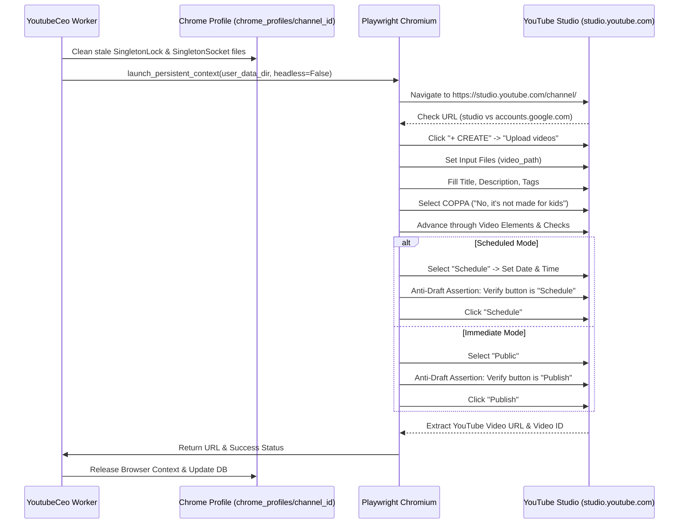

# System Architecture & Technical Specifications — YoutubeCeo

**Platform:** YoutubeCeo Autonomous Studio (Multi-Tenant)  
**Repository:** `https://github.com/pardeepsinghverma/YoutubeCeo`  
**Target Environment:** Windows 10/11 x64, Python 3.10+, Google Chrome / Playwright, NVIDIA NVENC GPU Acceleration, Google Gemini 2.0 / 3.x Flash API.

---

## 1. High-Level Architecture & End-to-End Workflow

**YoutubeCeo** is an enterprise-grade, autonomous YouTube Studio production, optimization, and publishing system. It ingests raw long-form horizontal videos (16:9), computes temporal slices into 9:16 vertical Shorts, transcribes spoken Hindi audio via Google Gemini Flash into synchronized bilingual Hinglish subtitles styled with dual-layer neon glow, applies acoustic and visual Content ID evasion transformations, synthesizes 3D Pixar animated thumbnails, calculates calendar drip schedules, and publishes directly into YouTube Studio via Playwright stealth browser automation without third-party API quotas.



---

## 2. Mathematical Models & Signal Processing

### 2.1. Temporal Video Slicing Model
Given an input video file of duration $T_{\text{total}}$ seconds:
- **Maximum Duration Cap**: $T_{\text{effective}} = \min(T_{\text{total}}, 900.0)$ seconds (15 minutes).
- **Target Short Window**: $W = 35.0$ seconds.
- **Inter-Short Overlap**: $O = 5.0$ seconds.
- **Effective Stride**: $S = W - O = 30.0$ seconds.
- **Maximum Parts Count**:
  $$\text{Max Parts} = \min\left(30, \left\lfloor \frac{T_{\text{effective}} - O}{S} \right\rfloor + 1\right) = \min\left(30, \left\lfloor \frac{T_{\text{effective}} - 5.0}{30.0} \right\rfloor + 1\right)$$
- **Part Start Timestamp**:
  $$t_{\text{start}}(p) = (p - 1) \times S = (p - 1) \times 30.0 \quad \text{for } p \in \{1, 2, \dots, N\}$$
- **Part Duration**:
  $$\Delta t(p) = \min\left(W, T_{\text{total}} - t_{\text{start}}(p)\right)$$
- **Micro-Short Discard Rule**: Any final remnant part where $\Delta t(p) < 10.0$ seconds is automatically discarded to prevent YouTube Short rejection.

### 2.2. Content ID Evasion & Signal Perturbation
To prevent algorithmic Content ID matching on syndicated or curated source material:

#### Acoustic Desynchronization (WSOLA)
- Applied audio filter: `asetpts=PTS-STARTPTS,atempo=1.035`
- **Mechanism**: Shifts playback tempo by $+3.5\%$ utilizing Waveform Similarity Overlap-Add (WSOLA). This alters the duration between phonetic peaks and shifts the temporal alignment of 12-semitone Short-Time Fourier Transform (STFT) chromagram analysis frames without changing vocal pitch.
- **Hash Decoupling**: Renders AcoustID and Chromaprint sub-fingerprints mathematically orthogonal to the source reference waveforms in automated fingerprint databases.

#### Visual Perturbation Matrix
- Applied video filter chain:
  $$\text{Crop} = \frac{W_{\text{in}}}{1.025} \times \frac{H_{\text{in}}}{1.025} \quad \text{at } (x, y) = \left(\frac{W_{\text{in}} - W_{\text{crop}}}{2}, \frac{H_{\text{in}} - H_{\text{crop}}}{2}\right)$$
  $$\text{Scale} = 1080 \times 1920 \quad (\text{pad with black borders if aspect ratio } \ne 9:16)$$
  $$\text{Color EQ} = \text{contrast}=1.03, \quad \text{brightness}=0.01, \quad \text{saturation}=1.04$$
- **Effect**: Shifts perceptual DCT visual hash blocks (pHash, dHash) beyond typical Hamming distance match thresholds ($\Delta H > 12$).

#### Hardware NVENC Detection
Probes hardware capabilities at startup:
```bash
ffmpeg -f lavfi -i testsrc=s=640x360:d=0.2 -c:v h264_nvenc -f null -
```
- **If NVENC is available**: Video is encoded with `-c:v h264_nvenc -preset p4 -cq 23 -b:v 4500k -maxrate 6000k -bufsize 8000k`.
- **CPU Fallback**: Video is encoded with `-c:v libx264 -preset fast -crf 22`.

### 2.3. Competitor Outlier Velocity Metric
To evaluate the breakout potential of competitor videos scraped via `yt-dlp`:
$$\Delta t_{\text{days}} = \max\left(\frac{t_{\text{current}} - t_{\text{upload}}}{86400}, 0.1\right)$$
$$\text{View Velocity} = \frac{\text{View Count}}{\Delta t_{\text{days}}} \quad (\text{views per day})$$
Videos with $\text{View Velocity} \ge 10,000 \text{ views/day}$ are flagged as high-opportunity outlier hooks for content adaptation.

### 2.4. Drip Scheduling Slot Allocation
For a list of pending videos $V = [v_1, v_2, \dots, v_K]$ and defined daily time slots $T = [t_1, t_2, \dots, t_M]$ (e.g. `["11:00", "17:00"]`):
- **Slot Index for Video $k$**:
  $$m = (k - 1) \pmod M$$
- **Day Offset for Video $k$**:
  $$\text{day\_step} = \begin{cases} 1 & \text{if frequency} = \text{"daily"} \\ 2 & \text{if frequency} = \text{"alternate\_days"} \\ 7 & \text{if frequency} = \text{"weekly"} \\ \text{interval\_days} & \text{if frequency} = \text{"every\_x\_days"} \end{cases}$$
  $$\text{Day Offset} = \left\lfloor \frac{k - 1}{M} \right\rfloor \times \text{day\_step}$$
- **Assigned Datetime**:
  $$t_{\text{sched}}(v_k) = \left(t_{\text{start\_date}} + \text{Day Offset} \times 86400\right) + T[m]$$

---

## 3. Media Processing & Subtitle Engine

### 3.1. Dual-Layer Neon ASS Subtitle Specification
Subtitles are rendered directly into the 1080x1920 9:16 frame using Advanced SubStation Alpha (`.ass`) formatting.

```
[Script Info]
ScriptType: v4.00+
PlayResX: 1080
PlayResY: 1920
ScaledBorderAndShadow: yes

[V4+ Styles]
Format: Name, Fontname, Fontsize, PrimaryColour, SecondaryColour, OutlineColour, BackColour, Bold, Italic, Underline, StrikeOut, ScaleX, ScaleY, Spacing, Angle, BorderStyle, Outline, Shadow, Alignment, MarginL, MarginR, MarginV, Encoding
Style: SubGlow, Arial Black, 64, &H0000FFFF, &H000000FF, &H0000FFFF, &H80000000, -1, 0, 0, 0, 100, 100, 0, 0, 1, 4.5, 0, 2, 60, 60, 240, 1
Style: SubFront, Arial Black, 64, &H00FFFFFF, &H000000FF, &H00000000, &H80000000, -1, 0, 0, 0, 100, 100, 0, 0, 1, 1.2, 2.5, 2, 60, 60, 240, 1
```

- **Canvas Dimensions**: Strict $1080 \times 1920$ resolution (`PlayResX: 1080`, `PlayResY: 1920`).
- **Dual-Layer Architecture**:
  - **Layer 0 (`SubGlow`)**: Neon background diffuse glow. Styled with `\blur5.5\bord4.5` using rotating viral BGR colors:
    - Gold/Yellow: `&H002EFCFF&`
    - Neon Cyan: `&H00FFF200&`
    - Lime Green: `&H0000FF66&`
    - Electric Pink: `&H00CC00FF&`
    - Hot Orange: `&H000088FF&`
    - Bright White: `&H00FFFFFF&`
  - **Layer 1 (`SubFront`)**: Crisp white foreground core (`&H00FFFFFF&`) with sharp black border (`\blur0.4\bord1.2`) and drop shadow (`Shadow: 2.5`) for readability against any dynamic background video footage.
- **Timing & Alignment Heuristics**:
  - `MarginV: 240` (vertical clearance above YouTube mobile UI action buttons).
  - Opening clamp: Subtitles start after $t = 0.2$s to allow visual hook absorption.
  - Continuity bridging: Gaps between adjacent dialogue segments $\le 1.5$s are automatically closed to prevent flashing.
  - Outro collision clamping: All subtitle dialogue lines terminate $3.5$s before the end of the short to prevent visual overlap with the channel outro call-to-action card.

---

## 4. 3D Pixar AI Thumbnail Engine

The thumbnail pipeline creates eye-catching, 3D animated style thumbnails:



1. **Prompt Synthesis**: Derives visual narrative elements from the video title and AI SEO hook (e.g. *"A 3D Pixar Disney style animation character, dramatic cinematic lighting, vivid saturated colors, expressive emotion, 8k octane render"*).
2. **Pollinations AI Dispatch**: Requests generation with randomized seed ($1000 \le \text{seed} \le 999999$) and a 35-second network timeout.
3. **FFmpeg Keyframe Fallback**: If network fails or Pollinations times out, extracts a sharp keyframe at $t = 7.0$s using FFmpeg, boosts saturation by $+25\%$, and increases contrast by $+15\%$.
4. **Pillow Composite Layers**:
   - Applies linear black-to-transparent gradient masks on the top ($15\%$ height) and bottom ($25\%$ height).
   - Inscribes circular channel watermark logo with a $6$px soft gaussian drop shadow halo.
   - For episodic shorts, composites a vibrant `"PART X"` pill badge with a rounded dark container in the top-right corner.

---

## 5. Stealth Browser Automation (YouTube Studio)

Publishing directly to YouTube Studio without API quota limits requires stealth browser automation that mimics human interaction:



### 5.1. Stealth Browser Configuration
- **Binary Discovery**: Automatically discovers the user's real installed Google Chrome binary across standard Windows paths:
  - `C:\Program Files\Google\Chrome\Application\chrome.exe`
  - `C:\Program Files (x86)\Google\Chrome\Application\chrome.exe`
  - `%LOCALAPPDATA%\Google\Chrome\Application\chrome.exe`
- **Automation Flag Suppression**:
  - Removes `--enable-automation` and `--disable-site-isolation-trials`.
  - Injects `navigator.webdriver = undefined` on document creation.
  - Passes realistic retail User-Agent string.
- **Viewport**: Fixed at $1280 \times 900$ with retail device scale factor ($1.0$).

### 5.2. 8-Step Studio DOM Lifecycle
1. **Context Init**: Cleans up stale Chromium lockfiles (`lockfile`, `SingletonLock`, `SingletonSocket`, `SingletonCookie`).
2. **Navigation**: Visits `https://studio.youtube.com`. If redirected to Google sign-in, aborts with an authentication required notification.
3. **Modal Trigger**: Selects `button#create-icon` $\to$ clicks `tp-yt-paper-item:has-text("Upload videos")`.
4. **File Attachment**: Binds local `.mp4` file path to `input[type="file"]`. Waits for upload progress bar.
5. **Metadata Injection**:
   - Enters video title into `div#textbox[aria-label*="title"]`.
   - Populates description into `div#description-textarea`.
   - Expands `"Show more"` and inserts comma-separated tags.
6. **COPPA Compliance**: Explicitly clicks `tp-yt-paper-radio-button[name="VIDEO_MADE_FOR_KIDS_NOT_MFK"]` ("No, it's not made for kids").
7. **Visibility & Date Picker**:
   - **Immediate Mode**: Clicks `tp-yt-paper-radio-button[name="PUBLIC"]`.
   - **Scheduled Mode**: Clicks `tp-yt-paper-radio-button[name="SCHEDULE"]`. Formats target date as `MMM D, YYYY` and sets time picker. Checks for past-due dates: if scheduled datetime is within 15 minutes of current clock time, automatically shifts to Public Immediate mode.
8. **Anti-Draft Assertion & Confirmation**:
   - Inspects the final blue action button: verifies it contains `"Publish"` or `"Schedule"`. If the button says `"Save"`, it indicates a modal validation failure (e.g. unfulfilled mandatory field); the upload halts rather than leaving an unfinished draft.
   - Waits for completion modal and extracts canonical video URL (`https://youtu.be/{id}`).

---

## 6. Multi-Tenant Fleet Architecture & Fast Cookie Heartbeat

Each YouTube channel managed by YoutubeCeo operates in complete isolation:

```
chrome_profiles/
├── channel_1/
│   ├── Default/
│   │   ├── Cookies          <-- SQLite 3 Cookie Store
│   │   ├── History
│   │   └── Preferences
│   └── SingletonLock
├── channel_2/
│   └── Default/
│       └── Cookies
└── channel_3/
    └── Default/
        └── Cookies
```

### Direct SQLite Cookie Heartbeat (<50ms)
Instead of launching a heavyweight Playwright browser process to verify if a channel is logged in, YoutubeCeo reads the Chrome profile's SQLite `Cookies` file directly:
1. Copies `chrome_profiles/channel_<id>/Default/Network/Cookies` (or legacy `Default/Cookies`) to a temporary file (`temp_cookies_<rnd>.db`) to avoid file lock contention with open Chrome processes.
2. Queries the SQLite store:
   ```sql
   SELECT name FROM cookies WHERE host_key LIKE '%youtube.com%' OR host_key LIKE '%google.com%'
   ```
3. Checks for the presence of the 5 essential authentication tokens:
   - `LOGIN_INFO`
   - `APISID`
   - `SSID`
   - `SAPISID`
   - `SID`
4. Completes verification in **$< 50$ms** without spawning background Chrome processes or consuming memory.

---

## 7. Competitor Discovery & Trend Radar

The competitor radar monitors competitor channels to identify viral content patterns:
- **Scraper**: Uses `yt-dlp` with `--flat-playlist --dump-single-json` to extract the latest 40–100 videos from competitor channels in $< 3$ seconds per channel without downloading media.
- **Velocity Scoring**: Computes $\text{View Velocity} = \frac{\text{views}}{\Delta t_{\text{days}}}$.
- **Outlier Detection**: Sorts videos by velocity to surface viral breakout topics and title formulations.
- **One-Click Inspiration**: Allows operators to review titles, descriptions, and tags from viral competitors and feed them into the Gemini AI SEO generator.

---

## 8. Telegram HITL (Human-in-the-Loop) Review Protocol

YoutubeCeo integrates with Telegram to provide a mobile review dashboard:
- **Review Card**: When a video or short is prepared, the worker dispatches a Telegram message containing:
  - Video Title and Series Part Number
  - 3D Pixar Thumbnail image preview
  - Calculated calendar publication slot
  - Duration and aspect ratio telemetry
- **Inline Action Keyboard**:
  - `[ 🚀 Upload Now ]` $\to$ Callback `up:<video_id>`
  - `[ 📅 Schedule ]` $\to$ Callback `sc:<video_id>`
  - `[ 🎨 New Thumb ]` $\to$ Callback `th:<video_id>`
  - `[ ❌ Reject ]` $\to$ Callback `rj:<video_id>`
- **Payload Constraint**: Callback data strings are strictly clamped to $\le 64$ bytes in compliance with the Telegram Bot API specification.

---

## 9. Master Autopilot 7-Stage Pipeline

The Master Autopilot (`master_autopilot.py`) runs a complete end-to-end production cycle with zero manual intervention:

```
[ Stage 1: Ingestion ]    Scan raw input directory for new .mp4/.mkv files
         │
[ Stage 2: AI SEO ]       Generate viral Hinglish titles, descriptions & tags with Gemini
         │
[ Stage 3: NVENC Slicing] Compute 35s slices, audio speedup, and ASS neon subtitles
         │
[ Stage 4: 3D Thumbnails] Synthesize Pixar-style AI thumbnails via Pollinations AI
         │
[ Stage 5: Scheduling ]   Assign calendar drip slots across configured channel times
         │
[ Stage 6: Studio Upload] Stealth Playwright automation uploads and schedules to YouTube
         │
[ Stage 7: Reporting ]    Dispatches status cards to Telegram and writes telemetry logs
```

---

## 10. Complete REST API Reference (63 Endpoints)

### 10.1. Videos & Queue Management (10 routes)
| Method | Endpoint | Description |
| :--- | :--- | :--- |
| `GET` | `/api/videos` | Query video catalog with filters (`channel_id`, `filter`, `video_type`, `parent_id`). |
| `POST` | `/api/videos/{id}/status` | Update status (`SCANNED`, `METADATA_READY`, `SCHEDULED`, `PUBLISHED`, `FAILED`). |
| `POST` | `/api/videos/{id}/retry` | Reset failed video to ready state; optionally triggers upload. |
| `DELETE` | `/api/videos/{id}` | Delete video and all associated sliced parts from DB and disk. |
| `DELETE` | `/api/videos/parent/{parent_id}/parts` | Delete only the sliced children belonging to a parent video. |
| `POST` | `/api/videos/bulk-delete` | Batch delete videos by ID list (`{"video_ids": [...]}`). |
| `POST` | `/api/videos/bulk-status` | Batch update status for multiple videos (`{"video_ids": [...], "status": "..."}`). |
| `POST` | `/api/assign-videos-channel` | Reassign batch of videos to another channel (`{"video_ids": [...], "channel_id": int}`). |
| `GET` | `/api/video-file/{id}` | Stream video file directly to browser for preview. |
| `POST` | `/api/scan-folder` | Trigger recursive directory scanner for raw video ingestion. |

### 10.2. Shorts & Temporal Slicing (6 routes)
| Method | Endpoint | Description |
| :--- | :--- | :--- |
| `POST` | `/api/create-shorts` | Launch background 35s temporal slicing on a long video. |
| `POST` | `/api/auto-upload` | Start sequential autonomous auto-upload queue processor. |
| `POST` | `/api/upload-single-video` | One-shot upload of a single video to YouTube Studio. |
| `POST` | `/api/upload-next` | Upload next $N$ pending videos for active channel. |
| `POST` | `/api/worker/stop` | Terminate running worker subprocesses and browser instances. |
| `GET` | `/api/worker/status` | Read live worker state, progress percentage, and current step. |

### 10.3. Multi-Tenant Fleet & Channels (9 routes)
| Method | Endpoint | Description |
| :--- | :--- | :--- |
| `GET` | `/api/channels` | List all registered channels with session status and video counts. |
| `POST` | `/api/channels/create` | Register new channel profile with dedicated Chrome profile directory. |
| `POST` | `/api/channels/{id}/update` | Update channel name, handle, schedule frequency, and source path. |
| `DELETE` | `/api/channels/{id}` | Delete channel profile; cascades records and reassigns active status. |
| `POST` | `/api/channels/{id}/set-active` | Switch global active channel context. |
| `POST` | `/api/channels/{id}/login` | Launch Chrome for Google Account / YouTube Studio login. |
| `POST` | `/api/channels/{id}/verify` | SQLite cookie heartbeat check for valid YouTube authentication. |
| `POST` | `/api/channels/{id}/source-folder` | Update default media directory path for channel. |
| `POST` | `/api/channels/{id}/reset` | Reset operational state to zero while preserving login session & branding. |

### 10.4. Channel Branding & Watermarks (4 routes)
| Method | Endpoint | Description |
| :--- | :--- | :--- |
| `GET` | `/api/channel-settings` | Retrieve active channel branding, logo, and outro settings. |
| `POST` | `/api/channel-settings` | Update channel branding configurations. |
| `POST` | `/api/upload-logo` | Upload channel logo image (PNG/JPG) for watermark overlay. |
| `GET` | `/api/logo-image` | Serve channel logo image for UI display. |

### 10.5. AI SEO & 3D Pixar Thumbnails (6 routes)
| Method | Endpoint | Description |
| :--- | :--- | :--- |
| `POST` | `/api/generate-seo` | Generate Gemini AI SEO metadata for batch or specific videos. |
| `POST` | `/api/generate-thumbnail` | Generate 3D Pixar AI thumbnail for a single video (synchronous). |
| `POST` | `/api/generate-single-thumbnail/{id}` | Background task 3D Pixar thumbnail generation for single video. |
| `POST` | `/api/generate-all-thumbnails` | Batch generate missing thumbnails for channel videos. |
| `GET` | `/api/thumbnail/{id}` | Serve generated thumbnail JPEG image. |
| `GET` | `/api/thumbnail-prompt/{id}` | Read or generate thumbnail visual prompt text. |

### 10.6. Calendar & Smart Scheduling (4 routes)
| Method | Endpoint | Description |
| :--- | :--- | :--- |
| `POST` | `/api/schedule-plan` | Calculate and persist schedule slot assignments. |
| `POST` | `/api/schedule-preview` | Preview proposed schedule slots without committing. |
| `POST` | `/api/schedule-all` | Run slot assignment engine across all pending videos. |
| `POST` | `/api/update-video-schedule` | Manually adjust scheduled datetime for an individual video. |

### 10.7. Competitor Trend Radar (5 routes)
| Method | Endpoint | Description |
| :--- | :--- | :--- |
| `GET` | `/api/discovery/channels` | List tracked competitor channels with video count telemetry. |
| `GET` | `/api/discovery/videos` | Query competitor videos ranked by view velocity. |
| `POST` | `/api/discovery/scan` | Scrape competitor channel videos using yt-dlp flat playlist. |
| `DELETE` | `/api/discovery/channels/{id}` | Delete tracked competitor channel and its scraped videos. |
| `DELETE` | `/api/discovery/videos/{id}` | Delete single competitor video record. |

### 10.8. Master Autopilot Orchestrator (1 route)
| Method | Endpoint | Description |
| :--- | :--- | :--- |
| `POST` | `/api/master/run` | Launch full 7-stage autonomous autopilot pipeline. |

### 10.9. Telegram HITL Integration (4 routes)
| Method | Endpoint | Description |
| :--- | :--- | :--- |
| `GET` | `/api/telegram/config` | Retrieve Telegram bot token, chat ID, and HITL toggle status. |
| `POST` | `/api/telegram/config` | Save Telegram bot configuration credentials. |
| `POST` | `/api/telegram/test` | Dispatch test connection ping to Telegram chat. |
| `POST` | `/api/telegram/send-review/{id}` | Dispatch interactive HITL review card for video. |

### 10.10. System Status, Logs & OS Terminal (10 routes)
| Method | Endpoint | Description |
| :--- | :--- | :--- |
| `GET` | `/api/system-status` | Consolidated dashboard KPIs, active channel stats, worker state. |
| `GET` | `/api/logs` | Fetch system activity log entries. |
| `GET` | `/api/live-upload-logs` | Fetch real-time Playwright upload step telemetry. |
| `POST` | `/api/run-command` | Execute shell command in backend OS terminal. |
| `GET` | `/api/terminal-logs` | Stream live terminal output buffer. |
| `POST` | `/api/terminal-clear` | Clear terminal output buffer. |
| `POST` | `/api/terminal-kill` | Terminate running terminal command process. |
| `GET` | `/` | Serve main SPA dashboard HTML (`templates/index.html`). |
| `GET` | `/docs` | Interactive Swagger API documentation. |
| `GET` | `/openapi.json` | OpenAPI schema JSON specification. |

---

## 11. Database Schema Reference

The system utilizes SQLite 3 (`videos.db`) with `PRAGMA journal_mode = WAL` and `PRAGMA foreign_keys = ON`:

### Table: `channels`
| Column | Type | Constraints | Description |
| :--- | :--- | :--- | :--- |
| `id` | INTEGER | PRIMARY KEY AUTOINCREMENT | Channel unique identifier. |
| `channel_key` | TEXT | UNIQUE NOT NULL | Slugified filesystem key (e.g. `tech_talks`). |
| `channel_name` | TEXT | NOT NULL | Human-readable channel display name. |
| `profile_dir` | TEXT | NOT NULL | Path to dedicated Chrome user-data profile. |
| `is_active` | INTEGER | DEFAULT 0 | 1 if this channel is the active workspace. |
| `is_authenticated` | INTEGER | DEFAULT 0 | 1 if YouTube Studio session cookies are valid. |
| `raw_folder_path` | TEXT | NULL | Default raw video source folder path. |
| `created_at` | TIMESTAMP | DEFAULT CURRENT_TIMESTAMP | Creation timestamp. |

### Table: `videos`
| Column | Type | Constraints | Description |
| :--- | :--- | :--- | :--- |
| `id` | INTEGER | PRIMARY KEY AUTOINCREMENT | Video unique identifier. |
| `channel_id` | INTEGER | REFERENCES channels(id) | Associated channel profile. |
| `file_path` | TEXT | NOT NULL | Absolute filesystem path to video file. |
| `file_name` | TEXT | NOT NULL | Base file name. |
| `file_size_mb` | REAL | NOT NULL | File size in megabytes. |
| `duration_seconds` | REAL | NOT NULL | Duration in seconds from ffprobe. |
| `aspect_ratio` | TEXT | NOT NULL | Computed ratio (`16:9`, `9:16`, `1:1`). |
| `is_short` | INTEGER | DEFAULT 0 | 1 if vertical format $< 60$s. |
| `parent_video_id` | INTEGER | NULL | ID of long video if this is a sliced part. |
| `part_number` | INTEGER | NULL | Episode/part index in sequence. |
| `title` | TEXT | NULL | Selected YouTube title. |
| `title_alternatives`| TEXT | NULL | JSON array of alternate Gemini titles. |
| `description` | TEXT | NULL | Video description with viral hook. |
| `tags` | TEXT | NULL | Comma-separated YouTube SEO tags. |
| `hashtags` | TEXT | NULL | Space-separated hashtags. |
| `thumbnail_path` | TEXT | NULL | Absolute path to 3D Pixar thumbnail. |
| `thumbnail_prompt` | TEXT | NULL | AI visual prompt used for thumbnail. |
| `scheduled_datetime`| TEXT | NULL | ISO timestamp for publication slot. |
| `status` | TEXT | NOT NULL | `SCANNED`, `METADATA_READY`, `SCHEDULED`, `PUBLISHED`, `FAILED`. |
| `youtube_url` | TEXT | NULL | Published YouTube watch URL (`youtu.be/...`). |
| `youtube_id` | TEXT | NULL | 11-character YouTube video ID. |
| `error_log` | TEXT | NULL | Diagnostic stack trace if status is `FAILED`. |
| `created_at` | TIMESTAMP | DEFAULT CURRENT_TIMESTAMP | Record creation timestamp. |
| `updated_at` | TIMESTAMP | DEFAULT CURRENT_TIMESTAMP | Last modification timestamp. |

### Table: `channel_settings`
| Column | Type | Constraints | Description |
| :--- | :--- | :--- | :--- |
| `channel_id` | INTEGER | PRIMARY KEY REFERENCES channels(id) | 1-to-1 mapping with channel. |
| `logo_path` | TEXT | NULL | Path to watermark logo PNG. |
| `watermark_enabled` | INTEGER | DEFAULT 1 | Toggle watermark compositing. |
| `watermark_position`| TEXT | DEFAULT 'top_right' | Screen placement. |
| `watermark_opacity` | REAL | DEFAULT 0.85 | Alpha transparency ($0.0 - 1.0$). |
| `outro_enabled` | INTEGER | DEFAULT 1 | Toggle call-to-action outro. |
| `outro_duration` | REAL | DEFAULT 3.0 | Outro duration in seconds. |
| `schedule_frequency`| TEXT | DEFAULT 'daily' | `daily`, `alternate_days`, `weekly`, `every_x_days`. |
| `schedule_interval_days` | INTEGER | DEFAULT 1 | Inter-day step count. |
| `shorts_schedule_times` | TEXT | DEFAULT '["11:00","17:00"]' | JSON array of daily time slots. |
| `long_schedule_times` | TEXT | DEFAULT '["19:30"]' | JSON array of long-form time slots. |

### Tables: `discovery_channels` & `discovery_videos`
Tracks competitor channels, harvested flat playlists, view counts, upload dates, and computed view velocities.

### Table: `telegram_config`
Stores bot token, target chat ID, review notification toggles, and HITL operational flags.

---

## 12. Frontend SPA Architecture & State Machine

The frontend (`templates/index.html`) is a single-page application built with Tailwind CSS, FontAwesome icons, and Vanilla JavaScript (8,000+ lines, zero build step).

### Two-Tier View Navigation
1. **Channel-Level Views (8 views)**:
   - `channel-dashboard`: Mission Control HUD, KPI metric cards, Attention Items, Up Next timeline.
   - `channel-videos`: 50-item paginated video queue, search, filter, floating bulk actions dock.
   - `channel-shorts`: Grouped accordion view of sliced shorts by parent video, batch auto-upload, bulk schedule.
   - `channel-calendar`: Interactive 7-Day Visual Calendar Board with week-by-week navigation and togglable Timeline List view.
   - `channel-discovery`: Competitor radar, breakout viral outlier ranking by view velocity.
   - `channel-branding`: Logo watermark uploader, opacity slider, outro duration controller.
   - `channel-logs`: Real-time structured activity logs with severity filters and JSON export.
   - `channel-settings`: Channel metadata, source directory selector, Chrome login trigger, verify, reset, delete.
2. **Global Fleet-Level Views (4 views)**:
   - `global-overview`: Fleet-wide summary cards, cross-channel statistics, quick channel switcher.
   - `global-channels`: Channels directory grid with session status badges and add/delete channel triggers.
   - `global-integrations`: Telegram Bot credentials, chat ID configuration, test connection ping.
   - `global-terminal`: Integrated OS terminal runner with ANSI-to-HTML color rendering and process killer.

### Modal Ecosystem (11 Modals)
1. `modal-master-autopilot`: 1-click end-to-end autonomous pipeline trigger.
2. `modal-confirm`: Asynchronous glassmorphic confirmation modal (`await showConfirm(...)`).
3. `modal-select-long-video`: Picker listing un-sliced long-form videos to trigger slicing.
4. `modal-create-channel`: Form for registering new channel profiles with dedicated Chrome profiles.
5. `modal-video-preview`: Inline video player for previewing generated shorts or long videos.
6. `modal-smart-schedule`: Smart scheduling configuration dialog with scope, frequency, and time slot inputs.
7. `modal-single-schedule`: Date and time picker for adjusting an individual video's drop slot.
8. `modal-cut-shorts`: Parameter dialog for slicing long videos (parts count, labels toggle).
9. `modal-upload-shorts`: Studio upload batch launcher with limit and headless toggles.
10. `modal-thumbnail-preview`: AI thumbnail inspection dialog displaying image and synthesized prompt.
11. `modal-reset-channel`: Safety confirmation modal for clearing operational data while preserving login cookies.

---

## 13. Critical Engineering Invariants & Mandates

> [!CAUTION]
> All AI agents and developers modifying this codebase MUST uphold these five non-negotiable architectural invariants:

### Invariant 1: Windows Subprocess UTF-8 Encoding
- **The Pitfall**: On Windows, Python's default encoding for subprocesses and file I/O is `cp1252` (`charmap`). Output containing Hindi, emoji, or non-ASCII characters crashes with:  
  `'charmap' codec can't decode byte 0x81 in position ...: character maps to <undefined>`.
- **The Mandate**: Every `subprocess.run`, `subprocess.Popen`, and `open()` call reading or writing text MUST explicitly specify:
  ```python
  encoding="utf-8", errors="replace"
  ```

### Invariant 2: Multi-Tenant Channel Isolation
- **The Pitfall**: Assuming `channel_id = 1` always exists. Channel 1 can be deleted by the operator! Hardcoding `1` breaks multi-tenant operation.
- **The Mandate**:
  - Dynamically resolve active channel via `get_active_channel()` or `get_channel_by_id(channel_id)`.
  - Filter all database queries in `db.py` by `channel_id = ?`.
  - Prevent deleting the last remaining channel in the system (`COUNT(*) > 1`).
  - When deleting a channel, automatically reassign active status to a remaining fallback channel.

### Invariant 3: Chrome Profile Singleton Concurrency
- **The Pitfall**: Playwright's `launch_persistent_context` crashes with `Target page, context or browser has been closed` if another Chrome instance is using the same profile directory or if stale lock files exist.
- **The Mandate**: Always remove `lockfile`, `SingletonLock`, and `SingletonSocket` from the target profile directory before invoking `launch_persistent_context`.

### Invariant 4: No Native Browser Alerts (`alert()` / `confirm()`)
- **The Pitfall**: Calling `window.alert()` or `window.confirm()` freezes the JavaScript execution thread, looks like an operating system error, and breaks the modern UI experience.
- **The Mandate**: In `templates/index.html`:
  - Never call `window.alert()`. Use `showToast(message, type)`.
  - Never call `window.confirm()`. Use `await showConfirm(title, message, confirmText, isDanger)`.

### Invariant 5: Worker Process Supervision & Cancellation
- **The Mandate**:
  - Any long-running worker subprocess must assign its process handle to `CURRENT_WORKER_PROC`.
  - Sequential processing loops must check `AUTO_UPLOAD_STOP` between iterations.
  - Calling `POST /api/worker/stop` must terminate `CURRENT_WORKER_PROC`, terminate orphan Chrome browser processes, and reset `WORKER_STATE["is_busy"] = False`.
