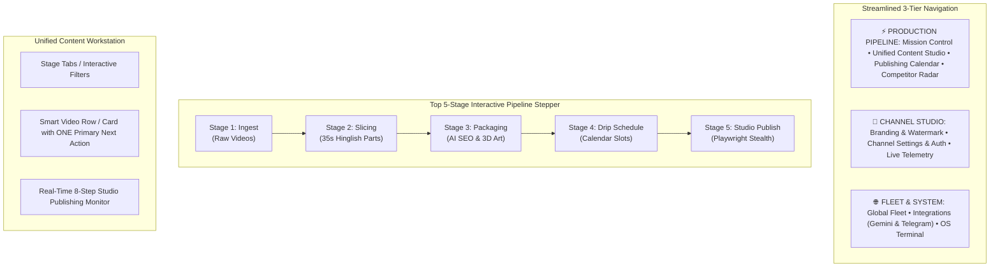

# V3 Master Architecture & UX Overhaul Blueprint — YoutubeCeo

> **Branch:** `v3`  
> **Platform:** YoutubeCeo Autonomous Studio (Multi-Tenant)  
> **Target:** Seamless, Intuitive, Production-Grade Flow & 100/100 UX Overhaul

---

## 1. Executive Summary & Core Purpose

### Why was this app built?
**YoutubeCeo** was created to solve the most grueling, time-consuming operational bottlenecks of running high-output automated YouTube channels (specifically Shorts channels focusing on serialized Hindi stories, crime files, documentaries, and viral narratives):

1. **Massive Video Repurposing & Slicing**:
   - Long-form videos (10–20 mins, 16:9) need to be surgically cut into 35-second vertical (9:16) Shorts with a 5-second overlap for narrative continuity.
   - Manual video slicing, cropping, scaling, and re-rendering in Premiere/CapCut takes hours per episode.
2. **Gemini AI Hinglish Subtitling with Neon Glow**:
   - YouTube Shorts retention depends heavily on dynamic, fast-paced animated subtitles.
   - Spoken Hindi audio must be extracted, transcribed, and formatted into bilingual Hinglish dialogue styled with dual-layer neon glow ASS subtitles (`SubGlow` + `SubFront`).
3. **Content ID Evasion & Signal Perturbation**:
   - Automated copyright and reuse filters flag identical acoustic and visual patterns.
   - The engine uses WSOLA audio time-stretching (`atempo=1.035`, $+3.5\%$ speed up without pitch shift) and visual perceptual perturbation (2.5% crop, color contrast/brightness matrix shift) to defeat automated acoustic and visual hash fingerprint matching.
4. **Visual Packaging (3D Pixar AI Thumbnails & AI SEO)**:
   - High Click-Through Rate (CTR) requires eye-catching 3D animated Pixar-style thumbnails composited with channel logo watermarks and "PART X" badges, plus Gemini-optimized viral titles, descriptions, and hashtags.
5. **Drip Scheduling**:
   - Dropping 20 shorts at once triggers YouTube spam filters. Shorts must be algorithmically spaced across peak viewer windows (e.g., 11:00 AM and 5:00 PM daily).
6. **Quota-Free YouTube Studio Automation**:
   - YouTube Data API v3 has an aggressive daily quota (10,000 units = only ~6 uploads/day).
   - YoutubeCeo uses stealth Playwright browser automation with persistent Google Chrome profiles (`chrome_profiles/channel_id`) to directly automate YouTube Studio (`studio.youtube.com`), setting Title, Description, Tags, Thumbnail, COPPA ("Not made for kids"), and Schedule datetime with zero quota restrictions.
7. **Multi-Tenant Channel Isolation**:
   - Running multiple distinct channels from one application without session cross-contamination.

---

## 2. Root Cause UX Audit: Why Current Flow is "10 out of 100"

| Issue # | Pain Point | Why It Breaks the User Experience |
| :--- | :--- | :--- |
| **P1** | **Fragmented & Redundant Views** | The sidebar lists 12 separate views. "Mission Control", "Video Queue", and "Shorts & Slicing" all contain overlapping video lists and redundant actions. The user doesn't know where to start or where their files went. |
| **P2** | **No Guided Linear Pipeline** | Users must guess the next step. There is no visible 5-stage production flow (`Ingest ➔ Slice ➔ Package ➔ Schedule ➔ Publish`). |
| **P3** | **Button Explosion (5 Different Upload Triggers)** | The UI presents `Quick Upload`, `Upload to YouTube`, `Auto Upload All`, `Auto Upload Parent`, and `Master Autopilot`. Each has subtly different behaviors, confusing the user. |
| **P4** | **Action Overload per Table Row** | Video rows have up to 8 tiny icon buttons (`Slice`, `SEO`, `Thumbnail`, `Preview`, `Upload`, `Schedule`, `Delete`, `Retry`). There is no prominent **Primary Next Action** telling the user what to do next with that video. |
| **P5** | **Blind Execution (Lack of Live Studio Progress)** | When uploading via Playwright, the user has to guess what's happening. The UI needs an 8-step live Studio HUD showing real-time automation progress (Profile ➔ Navigate ➔ File Attach ➔ Metadata ➔ COPPA ➔ Schedule ➔ Publish). |
| **P6** | **Calendar Disconnect** | The calendar only shows scheduled videos, while unscheduled videos sit invisibly in the queue. Scheduling feels like a separate chore rather than an integrated stage of production. |
| **P7** | **Cluttered Status Badges** | Raw statuses like `SCANNED`, `METADATA_READY`, `PARTS_GENERATED`, `SCHEDULED` are displayed as plain text badges without visual progression. |

---

## 3. The New V3 Experience Architecture

### 3.1. Unified Content Studio (Replacing Separate Queue & Shorts Tabs)
Instead of forcing the user to switch between "Video Queue" and "Shorts & Slicing", V3 provides a **Unified Content Studio** with:
- **Interactive Stage Pills**:
  - `All Media (Total)`
  - `1. Raw Media (Needs Slicing)`
  - `2. Sliced Shorts (Needs AI Packaging)`
  - `3. Packaged (Needs Scheduling)`
  - `4. Scheduled (Ready to Upload)`
  - `5. Published Live (Uploaded)`
- **Hierarchical Parent-Child Tree**:
  - Long videos display as parent cards.
  - Clicking expands its 35s sliced parts with visual thumbnail cards, part duration, and Hinglish subtitle status.
- **Smart Primary Action Button per Item**:
  - If `SCANNED` $\to$ **`[⚡ Slice into Shorts]`** (Accent Orange)
  - If `SLICED` $\to$ **`[✨ Generate AI SEO & Thumb]`** (Accent Purple)
  - If `METADATA_READY` $\to$ **`[📅 Assign Schedule Slot]`** (Accent Blue)
  - If `SCHEDULED` $\to$ **`[🚀 Upload to Studio Now]`** (Accent Red)
  - If `UPLOADING` $\to$ **`[⏳ Live Studio In-Flight...]`** (Pulsing Glow)
  - If `PUBLISHED` $\to$ **`[✅ Live on YouTube ↗]`** (Emerald Green)
  - If `FAILED` $\to$ **`[⚠️ 1-Click Fix & Retry]`** (Rose Danger)

### 3.2. Real-Time 8-Step Studio Telemetry HUD
When a video is being uploaded to YouTube Studio via Playwright, the dashboard displays a real-time HUD with 8 animated checkpoints:
1. `Chrome Profile Lock Cleaned`
2. `Studio Navigation & Session Verified`
3. `Create Modal & File Upload Streamed`
4. `AI Title, Description & Tags Injected`
5. `3D Pixar AI Thumbnail Attached`
6. `COPPA Compliance Verified ("Not Made for Kids")`
7. `Calendar Drip Date & Time Slot Asserted`
8. `Published / Scheduled Successfully!`

### 3.3. Streamlined Sidebar & Clear Information Hierarchy
- **Primary Group: PRODUCTION**
  - `Mission Control` (Channel overview, health, 1-click Autopilot)
  - `Content Studio` (The unified pipeline workstation)
  - `Publishing Calendar` (7-Day Visual Board & Drip Distribution)
  - `Competitor Radar` (Viral Outlier Discovery & yt-dlp Flat Playlist)
- **Secondary Group: CHANNEL SETUP**
  - `Branding & AI Art` (Logo watermark, neon subtitle styles, outro)
  - `Settings & Studio Auth` (Google Chrome login, media source folder, schedule rhythm)
  - `Live Telemetry & Logs` (System events, error tracking)
- **Tertiary Group: PLATFORM**
  - `Global Fleet` (Multi-channel overview)
  - `Integrations` (Gemini API & Telegram HITL)
  - `OS Terminal` (Direct CLI runner)

---

## 4. Execution Plan & Multi-Agent Swarm Roadmap

- **Task 1: Architecture & UI Blueprint (Complete)**
  - Authored this blueprint and verified all business requirements.
- **Task 2: Frontend Layout & Unified Studio Workstation (`templates/index.html`)**
  - Restructure navigation into the 3 clear functional tiers.
  - Build the Top 5-Stage Interactive Pipeline Stepper.
  - Replace redundant separate views with the Unified Content Studio.
  - Add Smart Primary Action buttons to each video card/row.
  - Integrate the Real-Time 8-Step Studio Publishing Monitor.
- **Task 3: Backend API Harmonization (`dashboard.py`)**
  - Ensure `/api/videos` provides stage aggregations and pipeline counts.
  - Ensure single-action endpoints (`/api/create-shorts`, `/api/generate-seo`, `/api/generate-single-thumbnail`, `/api/update-video-schedule`, `/api/upload-single-video`, `/api/auto-upload`) report atomic step updates.
  - Verify multi-tenant channel isolation invariants.
- **Task 4: Verification & Flow Testing**
  - Test end-to-end user journey: Channel Switch ➔ Ingest/Scan ➔ Slice ➔ AI SEO/Thumbnail ➔ Calendar Schedule ➔ Studio Upload.
  - Verify zero console errors and strict UTF-8 subprocess handling.
